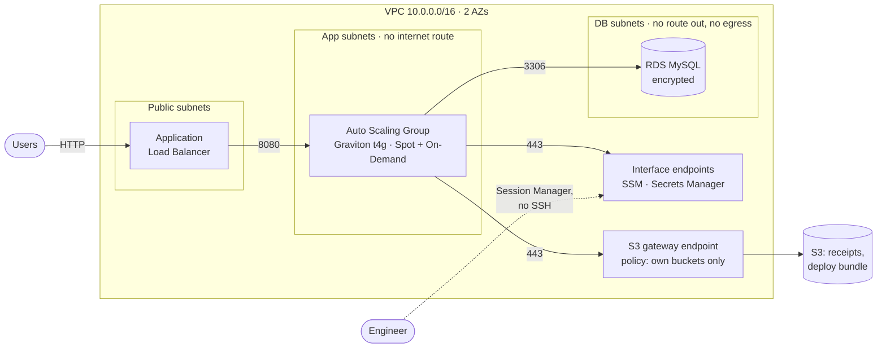
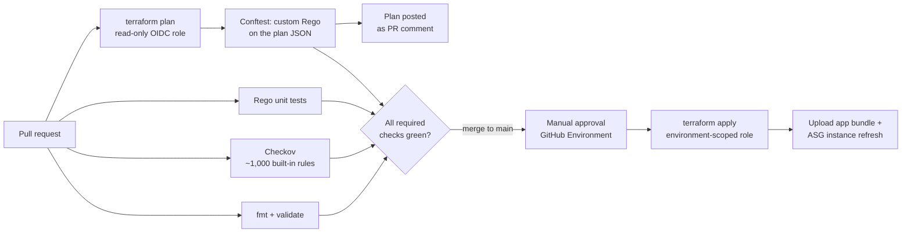

# Multi-cloud platform lab: secure 3-tier on AWS, landing zone on GCP

[](https://github.com/huyTrinhVAn/aws_architecture/actions/workflows/ci.yml)


A platform-engineering portfolio project: a **3-tier web app on AWS**,
built and run with the guardrails a regulated company would expect, and
now being extended to **Google Cloud** with a Shared VPC landing zone.

Every resource is Terraform. Every change goes through policy checks and
a reviewed plan. Nothing reaches the cloud without a human approval.

---

## At a glance

- 🔒 **No NAT Gateway, no SSH, no long-lived cloud keys.** Private subnets have no internet route, instances are reached through SSM, and CI authenticates with short-lived OIDC tokens.
- 🛡️ **Two layers of Policy as Code.** Checkov scans the code; custom **OPA/Rego** policies check the real Terraform plan, and a bad PR can't be merged.
- ✅ **Approval enforced by AWS, not just YAML.** The apply role only trusts jobs from an approved GitHub Environment.
- 🧱 **Reusable Terraform modules**, refactored from a flat config with `moved` blocks and **proven to change zero infrastructure**.
- ☁️ **GCP landing zone:** folder hierarchy, seed / host / service projects, remote state in GCS.
- 🐛 **Real incidents, root-caused.** Each one became a guardrail, documented in a [case study](docs/case-study.md).

## Architecture on AWS



| Tier | What runs there | Key controls |
|---|---|---|
| Public | ALB only | The only security group allowed `0.0.0.0/0`, and only on 80/443 |
| App | Flask API on Graviton, Spot above a 1-instance On-Demand baseline | Egress only to the endpoints, S3 and the DB; IMDSv2 required |
| Data | RDS MySQL, credentials in Secrets Manager | No egress at all; inbound 3306 from the app tier only |

## CI/CD and Policy as Code



Custom policies in [`policy/`](policy/) block:
- internet exposure on anything but the tagged load balancer
- SSH/RDP from any source
- unencrypted storage
- missing tags
- any plan that **deletes or replaces a database or bucket** without a prior approval PR

Details: [Policy as Code](docs/policy-as-code.md).

## GCP landing zone (in progress)

```
harrytrinh-lab.org (Organization: no SA keys, domain-restricted sharing)
└── sa-portfolio/
    ├── bootstrap/ → seed project      Terraform state (GCS), CI identity
    ├── shared/    → network host      Shared VPC: subnets, firewall, Cloud NAT
    └── dev/       → app service       VMs, HTTPS LB + Cloud Armor, Cloud SQL
```

Built in [`gcp-bootstrap/`](gcp-bootstrap/). Its state was applied locally,
then migrated into the bucket it created.

## Design decisions

| Decision | Why | Trade-off |
|---|---|---|
| VPC endpoints instead of a NAT Gateway | Private subnets get **zero** internet path; SSM makes SSH and bastions unnecessary | 4 interface endpoints × 2 AZs cost more than one NAT (~$58 vs ~$32/month), so the reason is security, not price. [Full arithmetic](docs/cost-optimization.md) |
| Separate CI roles: read-only plan, deploy, approval-gated apply | A compromised job only gets the permissions of that job | More IAM to maintain |
| Rego on the **plan**, not just Checkov on the code | Sees final values (variables, modules, `default_tags`) and lets us write org-specific rules | Needs a plan, so it needs credentials and state |
| `for_each` keyed by AZ instead of `count` | Removing one AZ doesn't re-create the others | One `moved` block per instance during the refactor |
| One state file per environment | Smaller blast radius and separate access control (state holds secrets) | Cross-environment references need data sources |
| Spot above an On-Demand baseline | The app tier is stateless, so losing a Spot instance is harmless | Capacity can dip briefly during Spot reclaims |

## Repository layout

```
envs/aws-dev/        AWS environment: module calls, backend, outputs, moved.tf
modules/             aws-network · aws-app · aws-database · aws-storage · aws-github-oidc
gcp-bootstrap/       GCP landing zone: folders, projects, state bucket
terraform-bootstrap/ S3 bucket for AWS Terraform state
policy/              OPA/Rego policies + unit tests
app/                 Budget Tracker API (Flask + MySQL) and tests
scripts/             boto3 cost-audit tool
docs/                write-ups, case study, interview prep
```

## Roadmap

| Phase | Status |
|---|---|
| AWS 3-tier: VPC endpoints, SSM, Graviton ASG, RDS, OIDC CI | ✅ Done |
| 1. Policy as Code: Checkov, Conftest, plan on PRs, approval-gated apply | ✅ Done |
| 2. Reusable modules, per-environment state, zero-change refactor | ✅ Done |
| 3. GCP 3-tier: Shared VPC, HTTPS LB + Cloud Armor, Cloud SQL, WIF | 🚧 In progress: landing zone done |
| 4. Hybrid AWS ↔ GCP: HA VPN, BGP, cross-cloud DNS | ⏳ Planned |
| 5. Observability and post-incident reviews | ⏳ Planned |
| 6. Agentic-ready IaC: safe automation guardrails | ⏳ Planned |

## Run the checks locally

```powershell
# Static scan, one directory at a time (see .checkov.yaml for why)
foreach ($d in "envs", "modules", "gcp-bootstrap") { checkov --config-file .checkov.yaml -d $d }

# Policy unit tests
conftest verify --policy policy

# Plan + policy check against the real plan
cd envs/aws-dev
terraform plan -out=tfplan
terraform show -json tfplan > plan.json
conftest test plan.json --policy ../../policy --all-namespaces
```

The app runs locally with Docker MySQL: see [app/README.md](app/README.md).

> 💰 **Cost:** the AWS stack is destroyed between sessions; only IAM roles
> and the state bucket stay up. GCP runs on the free trial with a budget alert.

## Documentation

| Doc | What's inside |
|---|---|
| [Case study](docs/case-study.md) | STAR write-up: decisions, real incidents, results |
| [Policy as Code](docs/policy-as-code.md) | How the gates work, triage of all 41 initial findings |
| [Terraform modules](docs/terraform-modules.md) | Module design, state migration, proof of zero change |
| [Cost optimization](docs/cost-optimization.md) | NAT Gateway vs VPC endpoints, with the real numbers |
| [AWS vs GCP](docs/aws-vs-gcp.md) | Only what actually works differently: networking in full, plus IAM, credentials, billing |
| [Interview prep](docs/interview-prep.md) | Questions and model answers for every phase |
